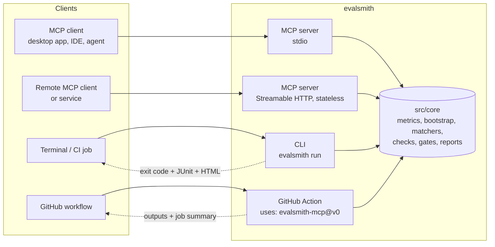
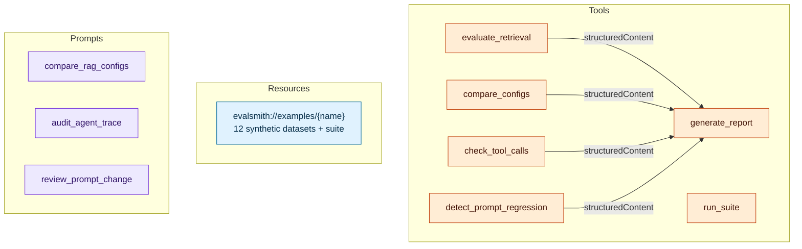
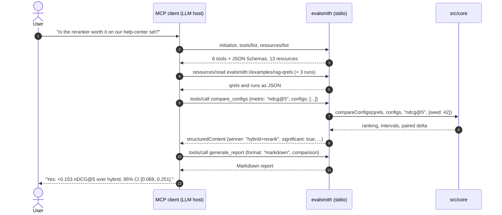
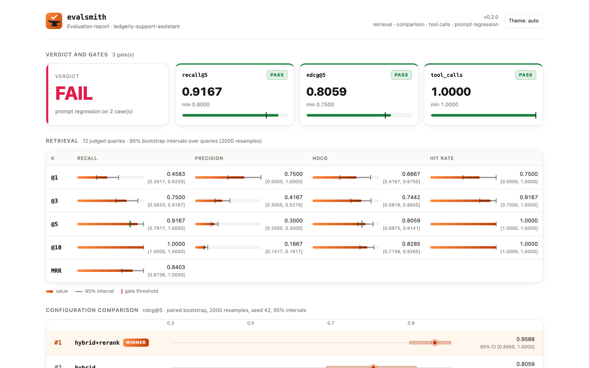
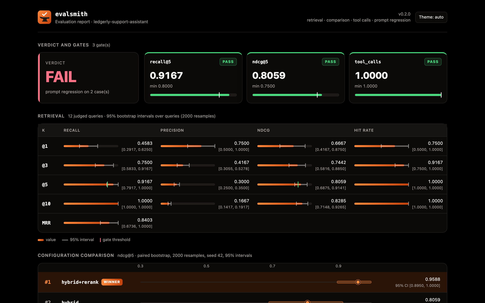
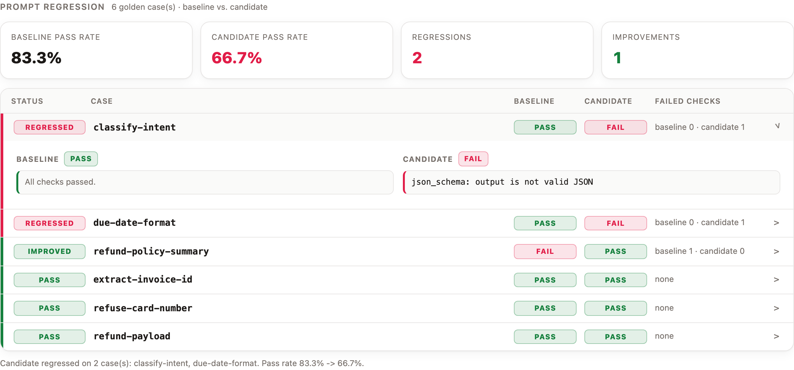
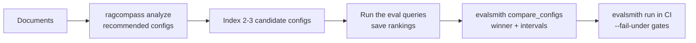

<div align="center">


# evalsmith-mcp

**Evaluate RAG retrieval and AI agents with deterministic metrics, from any MCP client or from CI.**

[](.nvmrc)
[](tsconfig.json)
[](https://github.com/modelcontextprotocol/typescript-sdk)
[](https://github.com/diegoperezg7/evalsmith-mcp/actions/workflows/ci.yml)
[](#design-decisions)
[](https://www.npmjs.com/package/evalsmith-mcp)
[](LICENSE)
[](https://m8ven.ai/mcp/diegoperezg7-evalsmith-mcp-1ocx4x?s=readme)
[](https://glama.ai/mcp/servers/diegoperezg7/evalsmith-mcp)

</div>

evalsmith answers four questions that come up every time a retriever, prompt or agent changes:

1. **Is retrieval good enough?** recall@k, precision@k, nDCG@k, hit rate and MRR from qrels and a ranked run.
2. **Which configuration is better, and is the gap real?** 2-3 configurations ranked with seeded paired-bootstrap confidence intervals.
3. **Did the agent call the right tools?** Trace vs. expected calls, strict or lax order, argument matchers.
4. **Did the prompt change break anything?** Golden-set checks on baseline vs. candidate outputs.

Everything is deterministic and runs offline. An LLM judge exists for a second opinion, but it is off by default and never decides the verdict. Results come out as a terminal table, Markdown, JSON, JUnit XML or a [self-contained HTML report](#html-report), and the [GitHub Action](#github-action) turns them into a merge gate.

<p align="center"></p>

---

## Interfaces over the same core



| Interface                    | Entry point                           | Who uses it                                           | Why it exists                                                                                                         |
| ---------------------------- | ------------------------------------- | ----------------------------------------------------- | --------------------------------------------------------------------------------------------------------------------- |
| **MCP over stdio**           | `dist/mcp/server.js`                  | Desktop MCP clients, IDE assistants, local agents     | An assistant can score a run, compare configs or audit a trace mid-conversation, with typed `structuredContent` back. |
| **MCP over Streamable HTTP** | `EVALSMITH_TRANSPORT=http`            | Remote clients, internal platforms, the MCP Inspector | Same tools over the network. Stateless: no sessions to store, scales horizontally.                                    |
| **CLI / CI**                 | `evalsmith run evalsmith.yaml`        | Pipelines and terminals                               | `--fail-under recall@5=0.8` turns a metric into a merge gate. Exit codes, Markdown summary, JUnit XML, HTML report.   |
| **GitHub Action**            | `uses: diegoperezg7/evalsmith-mcp@v0` | GitHub workflows                                      | The same gates as a step, with outputs, a job summary and no install.                                                 |

All four call the same functions in [`src/core`](src/core). The MCP tools are thin adapters: parse input with Zod, call the core, return `structuredContent` validated against an output schema.

---

## MCP surface



### Tools

Every tool declares an input and an output Zod schema, returns `structuredContent` plus a JSON text block, and is annotated `readOnly` and non-destructive. Four tools are also idempotent and closed-world. `detect_prompt_regression` and `run_suite` are declared open-world and non-idempotent: annotations are per tool, and with the judge enabled they call an external model whose answers can vary. With the judge off (the default) they behave like the others.

| Tool                       | Input                                                                                                           | Output                                                                                             |
| -------------------------- | --------------------------------------------------------------------------------------------------------------- | -------------------------------------------------------------------------------------------------- |
| `evaluate_retrieval`       | `qrels`, `run`, optional `k` list                                                                               | Mean recall/precision/nDCG/hit rate at every k, MRR, per-query values, skipped and missing queries |
| `compare_configs`          | `qrels`, 2-3 `{name, run}`, primary `metric`, `bootstrap {samples, seed, confidence}`                           | Ranking with intervals, winner, runner-up, paired interval of the gap, `significant`               |
| `check_tool_calls`         | `trace` as logged (evalsmith, Anthropic Messages, OpenAI Chat or Responses), `expected`, `order: strict \| lax` | `passed`, score, matched position and reasons per expected call, unexpected calls                  |
| `detect_prompt_regression` | `golden`, `baseline`, `candidate`, optional `judge {enabled}`                                                   | Verdict, pass rates, regressions, improvements, per-case failures, judge votes when enabled        |
| `generate_report`          | Any of the results above, `gates`, `format: markdown \| json \| junit`                                          | `passed`, rendered report                                                                          |
| `run_suite`                | Optional `config` path to an `evalsmith.yaml`, `gates`, `judge`, `format`                                       | `passed`, rendered report and every section's results, read from the suite's files                 |

`run_suite` runs the same suites as `evalsmith run`, so a client can evaluate data that lives in files instead of pasting it into the conversation. It only reads inside the workspace root (`EVALSMITH_ROOT`, the directory the server started in by default), following symlinks before it checks, and runs the bundled example suite when no `config` is given.

Bad input (unknown metric, duplicate config names, qrels with no relevant documents) comes back as an `InvalidParams` tool error with a message the model can act on. A judge endpoint that is down or returns an HTTP error is an `InternalError`.

### Resources

`evalsmith://examples/{name}` lists and serves the synthetic datasets in [`examples/datasets`](examples/datasets), so a client can try every tool before wiring in its own data:

| Name                                                                                     | Content                                                                               |
| ---------------------------------------------------------------------------------------- | ------------------------------------------------------------------------------------- |
| `rag-corpus`, `rag-queries`, `rag-qrels`                                                 | 20 help-center articles of a fictional invoicing app, 12 questions, graded judgements |
| `rag-run-bm25`, `rag-run-hybrid`, `rag-run-hybrid-rerank`                                | Top-10 rankings from three retrieval configurations                                   |
| `agent-trace`, `agent-expected`                                                          | A support agent refunding a duplicate charge, and the calls it should make            |
| `prompts-golden`, `prompts-baseline`, `prompts-candidate`, `prompts-candidate-regressed` | Six golden cases and three sets of outputs                                            |
| `suite`                                                                                  | The example [`evalsmith.yaml`](examples/evalsmith.yaml)                               |

### Prompts

| Prompt                 | Argument    | What it asks the model to do                                                         |
| ---------------------- | ----------- | ------------------------------------------------------------------------------------ |
| `compare_rag_configs`  | `metric`    | Compare the configurations, report the gap with its interval and the weakest queries |
| `audit_agent_trace`    | `order`     | Check the trace and propose the smallest fix for each failed step                    |
| `review_prompt_change` | `candidate` | Detect regressions, build a Markdown report, decide ship / do not ship               |

### A conversation with an MCP client



---

## Metrics

For a query $q$ with relevant set $R_q$ (documents with grade $> 0$) and ranking $D_q$, with $D_q^{k}$ its first $k$ documents:

```math
\mathrm{Recall@}k = \frac{|R_q \cap D_q^{k}|}{|R_q|}
\qquad
\mathrm{Precision@}k = \frac{|R_q \cap D_q^{k}|}{k}
\qquad
\mathrm{HitRate@}k = \mathbb{1}\left[\,R_q \cap D_q^{k} \neq \varnothing\,\right]
```

```math
\mathrm{RR}_q = \frac{1}{\text{rank of the first relevant document}}
\qquad
\mathrm{MRR} = \frac{1}{|Q|}\sum_{q \in Q} \mathrm{RR}_q
```

```math
\mathrm{DCG@}k = \sum_{i=1}^{k} \frac{\mathrm{rel}_i}{\log_2(i+1)}
\qquad
\mathrm{nDCG@}k = \frac{\mathrm{DCG@}k}{\mathrm{IDCG@}k}
```

$\mathrm{rel}_i$ is the graded judgement of the document at rank $i$ (linear gain, as in `trec_eval`), and IDCG is the DCG of the judgements sorted in descending order. Reported values are means over judged queries.

Conventions, all covered by tests:

- Queries whose judgements are all 0 are skipped and listed in `skippedQueries`.
- Judged queries missing from the run score 0 and are listed in `missingFromRun`.
- Precision divides by $k$, not by the ranking length.
- Repeated document ids in a ranking keep only their first position, as in `trec_eval`, so a run cannot score above 1 by repeating a relevant document.
- Cut-offs start at 1: `recall@0` is rejected.

**Worked example** ([`tests/core/retrieval.test.ts`](tests/core/retrieval.test.ts)): judgements `a=2, b=1, c=0`, ranking `d, a, e, b, c`.
DCG@5 $= 2/\log_2 3 + 1/\log_2 5 = 1.69254$, IDCG@5 $= 2/\log_2 2 + 1/\log_2 3 = 2.63093$, so nDCG@5 $= 0.64332$; recall@3 $= 0.5$, precision@5 $= 0.4$, RR $= 0.5$.

**Bootstrap.** `compare_configs` resamples queries with replacement, using the same indices for every configuration (paired), `samples` times, from a seeded PRNG (mulberry32). Intervals are percentiles of the resampled means. The lead is `significant` when the interval of winner minus runner-up excludes zero. The same seed gives the same intervals on every machine.

### Tool-call matchers

```json
{
  "tool": "create_refund",
  "args": {
    "invoice_id": { "type": "exact", "value": "INV-2041" },
    "reason": { "type": "any" },
    "metadata": { "type": "subset", "value": { "ticket": "T-5532" } },
    "to": { "type": "regex", "pattern": "@acme-robotics\\.example$" }
  }
}
```

`strict` requires the trace to be exactly the expected calls in order; calls past the expected sequence fail the check and appear as failed test cases in JUnit. `lax` ignores order and pairs expected calls with trace calls by maximum bipartite matching (augmenting paths), so a loose matcher never steals the only call a stricter one accepts. Extra calls are reported without failing. Every matcher, `exact` included, fails when the argument is missing.

### Prompt checks

`exact` (trimmed by default), `regex`, `contains` (case-insensitive by default), `json_schema` (the output is parsed and validated with Ajv) and `length` (`min` / `max` characters). A **regression** is a case that passes on the baseline and fails on the candidate. Missing outputs count as failures.

The optional judge sends both outputs to any OpenAI-compatible `/chat/completions` endpoint, Ollama included, at temperature 0. To cancel position bias each case is judged twice, with baseline as answer A and then as answer B. A side wins only when both orderings agree; a disagreement counts as a tie. That costs two requests per case. Its votes are reported next to the verdict.

---

## Quickstart

```bash
npx -y evalsmith-mcp                       # MCP server on stdio
npm install -g evalsmith-mcp               # or install the `evalsmith` CLI and `evalsmith-mcp` server
docker build -t evalsmith-mcp . && docker run --rm -i evalsmith-mcp   # or run the server in a container
```

To run the bundled examples and the tests from source:

```bash
git clone https://github.com/diegoperezg7/evalsmith-mcp.git
cd evalsmith-mcp
npm ci            # also builds dist/ through the prepare script
npx playwright install chromium   # the HTML report tests open it in a real browser
npm test          # metrics, traces, MCP in-memory + HTTP, CLI exit codes, HTML report, action

node dist/cli/index.js run examples/evalsmith.yaml
```

### Connect an MCP client (stdio)

[](https://cursor.com/en/install-mcp?name=evalsmith&config=eyJjb21tYW5kIjoibnB4IiwiYXJncyI6WyIteSIsImV2YWxzbWl0aC1tY3AiXX0=)
[](https://insiders.vscode.dev/redirect/mcp/install?name=evalsmith&config=%7B%22command%22%3A%22npx%22%2C%22args%22%3A%5B%22-y%22%2C%22evalsmith-mcp%22%5D%7D)

From a terminal:

```bash
claude mcp add evalsmith -- npx -y evalsmith-mcp     # Claude Code
codex mcp add evalsmith -- npx -y evalsmith-mcp      # Codex CLI
code --add-mcp '{"name":"evalsmith","command":"npx","args":["-y","evalsmith-mcp"]}'   # VS Code
```

Other desktop MCP clients read an `mcpServers` block like this ([`examples/mcp-client-config.json`](examples/mcp-client-config.json)):

```json
{
  "mcpServers": {
    "evalsmith": {
      "command": "npx",
      "args": ["-y", "evalsmith-mcp"],
      "env": { "LOG_LEVEL": "warn" }
    }
  }
}
```

Restart the client, then try the `compare_rag_configs` prompt or ask it to read `evalsmith://examples/agent-trace` and check it.

### Streamable HTTP

```bash
EVALSMITH_TRANSPORT=http EVALSMITH_HTTP_PORT=3333 node dist/mcp/server.js
curl -s localhost:3333/healthz                  # {"status":"ok","version":"0.1.0"}
npx @modelcontextprotocol/inspector             # connect to http://127.0.0.1:3333/mcp
```

| Variable                                      | Default                     | Purpose                                             |
| --------------------------------------------- | --------------------------- | --------------------------------------------------- |
| `EVALSMITH_TRANSPORT`                         | `stdio`                     | `stdio` or `http`                                   |
| `EVALSMITH_HTTP_HOST` / `EVALSMITH_HTTP_PORT` | `127.0.0.1` / `3333`        | HTTP bind address                                   |
| `EVALSMITH_JUDGE_BASE_URL`                    | `http://localhost:11434/v1` | OpenAI-compatible endpoint for the optional judge   |
| `EVALSMITH_JUDGE_MODEL`                       | `llama3.1:8b`               | Judge model                                         |
| `EVALSMITH_JUDGE_API_KEY`                     | unset                       | Only for hosted endpoints                           |
| `EVALSMITH_ROOT`                              | current directory           | Directory `run_suite` may read suites and data from |
| `LOG_LEVEL`                                   | `info`                      | pino level; logs always go to stderr                |

---

## CLI and CI

```bash
evalsmith run <config> [--fail-under metric=value ...] [--format table|json|markdown|html]
                       [--report file.{md,json,xml,html}] [--report-format markdown|json|junit|html]
evalsmith doctor [config] [--judge]
```

Gates accept `recall@k`, `precision@k`, `ndcg@k`, `hit_rate@k`, `mrr`, `tool_calls` (score of `check_tool_calls`) and `prompt_pass_rate`. Gates in the YAML file apply too; a command-line gate with the same name overrides it. A prompt regression or a failed tool-call check fails the run even without gates.

| Exit code | Meaning                                                                                |
| --------- | -------------------------------------------------------------------------------------- |
| `0`       | Every gate passed, no regression                                                       |
| `1`       | A gate is below its threshold, the candidate regressed, or the tool calls do not match |
| `2`       | Usage error, invalid config, unknown metric, unreadable dataset, judge endpoint down   |

### Real output

`node dist/cli/index.js run examples/evalsmith.yaml` on the bundled datasets ([`examples/evalsmith.yaml`](examples/evalsmith.yaml)):

```text
evalsmith · ledgerly-support-assistant

Retrieval (12 queries, MRR 0.8403)
┌────┬────────┬───────────┬────────┬──────────┐
│  k │ recall │ precision │   nDCG │ hit rate │
├────┼────────┼───────────┼────────┼──────────┤
│  1 │ 0.4583 │    0.7500 │ 0.6667 │   0.7500 │
│  3 │ 0.7500 │    0.4167 │ 0.7442 │   0.9167 │
│  5 │ 0.9167 │    0.3000 │ 0.8059 │   1.0000 │
│ 10 │ 1.0000 │    0.1667 │ 0.8285 │   1.0000 │
└────┴────────┴───────────┴────────┴──────────┘

Comparison on ndcg@5 (paired bootstrap, 2000 samples, seed 42)
┌───┬───────────────┬────────┬──────────────────┐
│ # │ config        │ ndcg@5 │ 95% CI           │
├───┼───────────────┼────────┼──────────────────┤
│ 1 │ hybrid+rerank │ 0.9588 │ [0.8950, 1.0000] │
│ 2 │ hybrid        │ 0.8059 │ [0.6875, 0.9141] │
│ 3 │ bm25          │ 0.5596 │ [0.3782, 0.7354] │
└───┴───────────────┴────────┴──────────────────┘
hybrid+rerank wins on ndcg@5 (0.9588), +0.1528 over hybrid; 95% interval of the gap [0.0692, 0.2506] excludes zero.

Agent tool calls (strict)
┌──────────────────┬─────────┬────────┬───────┐
│ expected         │ matched │ status │ notes │
├──────────────────┼─────────┼────────┼───────┤
│ search_customers │ #1      │ pass   │       │
│ get_invoice      │ #2      │ pass   │       │
│ create_refund    │ #3      │ pass   │       │
│ send_email       │ #4      │ pass   │       │
└──────────────────┴─────────┴────────┴───────┘
All 4 expected call(s) matched (strict order).

Prompt regression
┌───────────────────────┬──────────┬───────────┬────────────────────┐
│ case                  │ baseline │ candidate │ candidate failures │
├───────────────────────┼──────────┼───────────┼────────────────────┤
│ classify-intent       │ pass     │ pass      │                    │
│ extract-invoice-id    │ pass     │ pass      │                    │
│ refund-policy-summary │ fail     │ pass      │                    │
│ due-date-format       │ pass     │ pass      │                    │
│ refuse-card-number    │ pass     │ pass      │                    │
│ refund-payload        │ pass     │ pass      │                    │
└───────────────────────┴──────────┴───────────┴────────────────────┘
No regressions across 6 case(s). Pass rate 83.3% -> 100.0%.

Gates
┌────────────┬────────┬────────┬────────┐
│ metric     │    min │ actual │ status │
├────────────┼────────┼────────┼────────┤
│ recall@5   │ 0.8000 │ 0.9167 │ pass   │
│ ndcg@5     │ 0.7500 │ 0.8059 │ pass   │
│ tool_calls │ 1.0000 │ 1.0000 │ pass   │
└────────────┴────────┴────────┴────────┘

PASS
```

Raising the bar makes the same run fail the build:

```text
$ node dist/cli/index.js run examples/evalsmith.yaml --fail-under recall@5=0.95 --fail-under mrr=0.9 --report report.xml
...
Gates
┌────────────┬────────┬────────┬────────┐
│ metric     │    min │ actual │ status │
├────────────┼────────┼────────┼────────┤
│ recall@5   │ 0.9500 │ 0.9167 │ FAIL   │
│ ndcg@5     │ 0.7500 │ 0.8059 │ pass   │
│ tool_calls │ 1.0000 │ 1.0000 │ pass   │
│ mrr        │ 0.9000 │ 0.8403 │ FAIL   │
└────────────┴────────┴────────┴────────┘

FAIL · 2 gate(s) below threshold
Report written to report.xml
$ echo $?
1
```

### HTML report

`--report report.html` (or `--format html` on stdout) writes the whole run to one HTML file that opens offline and follows the system light or dark mode:

- the verdict, and a card per gate with its value, threshold and status;
- retrieval metrics per k as bars with a bootstrap interval over the queries, and gate thresholds marked on them;
- the configuration comparison with each interval, the winner and the gap to the runner-up;
- expected vs. actual tool calls, with the matched pairs linked and mismatches flagged;
- baseline vs. candidate per golden case, with the failing checks one click away.

<p align="center"></p>

<details>
<summary>Dark mode and an opened prompt regression</summary>

<p align="center"></p>
<p align="center"></p>

</details>

Dataset text (case ids, tool names, failure messages) is embedded as JSON in a non-executable `<script type="application/json">` block and rendered with `textContent` only. A Content-Security-Policy allows no network access and only the page's own script, by hash. Tests open a report full of markup in Chromium and check that nothing from it runs. `npm run docs:screenshots` regenerates the pictures above.

---

## GitHub Action

```yaml
- uses: actions/checkout@v5
- uses: diegoperezg7/evalsmith-mcp@v0
  id: evals
  with:
    config: evals/evalsmith.yaml
    fail-under: |
      recall@5=0.8
      ndcg@10=0.7
      tool_calls=1
    html-report: evalsmith-report.html
```

The step fails when a gate is below its threshold, the prompt candidate regresses or the tool calls do not match, and writes the Markdown report with the verdict to the job summary. It runs the same core as the CLI from a bundled `node24` script, with no install step and no shell. [`examples/github-workflow.yml`](examples/github-workflow.yml) is a complete workflow that also keeps the HTML report as an artifact and publishes the JUnit XML as a check run.

| Input            | Default          | Description                                                                                             |
| ---------------- | ---------------- | ------------------------------------------------------------------------------------------------------- |
| `config`         | `evalsmith.yaml` | Suite file. Dataset paths inside it are relative to the file                                            |
| `fail-under`     |                  | One `metric=value` per line. Adds to the gates in the suite file and overrides those with the same name |
| `report-file`    |                  | Report file: `.md`, `.json`, `.xml` (JUnit) or `.html`                                                  |
| `report-format`  | from extension   | `markdown`, `json`, `junit` or `html`                                                                   |
| `html-report`    |                  | Path for the self-contained HTML report                                                                 |
| `upload-summary` | `true`           | Append the Markdown report to the job summary                                                           |

| Output               | Description                                                                         |
| -------------------- | ----------------------------------------------------------------------------------- |
| `verdict`            | `pass` or `fail`                                                                    |
| `failed-gates`       | Gates below their threshold                                                         |
| `metrics`            | Retrieval metrics as JSON, e.g. `fromJSON(steps.evals.outputs.metrics)['recall@5']` |
| `mrr`                | MRR of the retrieval run                                                            |
| `tool-calls`         | Tool-call score, matched / expected                                                 |
| `prompt-pass-rate`   | Candidate pass rate on the golden set                                               |
| `prompt-regressions` | Cases that pass on baseline and fail on candidate                                   |
| `winner`             | Winning configuration of the comparison                                             |
| `report-file`        | Path of `report-file`, empty when not requested                                     |
| `html-report`        | Path of the HTML report, empty when not requested                                   |

Outputs of a section the suite does not have are empty. Dataset text printed to the log is wrapped in `::stop-commands::`, so a case id or tool name cannot issue workflow commands. The judge reads `EVALSMITH_JUDGE_*` from the step environment, as the CLI does.

Without the action, the CLI does the same from any CI:

```bash
npx evalsmith run evals/evalsmith.yaml --fail-under recall@5=0.8 --format markdown --report evalsmith-report.xml >> "$GITHUB_STEP_SUMMARY"
```

---

## Suite file

```yaml
name: ledgerly-support-assistant
retrieval:
  qrels: datasets/rag/qrels.json # { queryId: { docId: grade } }
  run: datasets/rag/runs/hybrid.json # { queryId: [docId, ...] }
  k: [1, 3, 5, 10]
compare:
  metric: ndcg@5
  configs:
    - { name: bm25, run: datasets/rag/runs/bm25.json }
    - { name: hybrid, run: datasets/rag/runs/hybrid.json }
    - { name: hybrid+rerank, run: datasets/rag/runs/hybrid-rerank.json }
  bootstrap: { samples: 2000, seed: 42, confidence: 0.95 }
agent:
  trace: datasets/agent/trace.json
  expected: datasets/agent/expected.json
  order: strict
prompts:
  golden: datasets/prompts/golden.json
  baseline: datasets/prompts/baseline.json
  candidate: datasets/prompts/candidate.json
  judge: { enabled: false }
gates:
  recall@5: 0.8
  ndcg@5: 0.75
  tool_calls: 1.0
```

Every section is optional. Paths are relative to the YAML file.

---

## Pairs with ragcompass

[ragcompass](https://github.com/diegoperezg7/ragcompass) profiles a corpus and recommends how to configure the RAG pipeline: parser, chunking, top-k, hybrid search, reranking. evalsmith checks whether that configuration holds up:



---

## Design decisions

- **Deterministic first.** Metrics, matchers and checks are pure functions with hand-computed tests. A model is never needed to get a verdict, so results do not drift between runs and no paid API key is required.
- **Judge off by default.** When enabled it goes through any OpenAI-compatible endpoint (local Ollama works), and its votes sit next to the verdict instead of changing it.
- **Intervals, not just means.** Twelve queries can make a 0.03 lead look decisive. A paired bootstrap with a fixed seed makes the uncertainty visible and reproducible.
- **Stateless HTTP done properly.** A stateless `StreamableHTTPServerTransport` cannot be reused across requests, so every POST gets its own server and transport. Registration is cheap, and a test makes two consecutive calls over real HTTP to prove it.
- **stdout belongs to the protocol.** pino writes to stderr and ESLint forbids `console` in `src/`, so no stray byte breaks the stdio transport. The CLI keeps stdout for results only.
- **One schema, three uses.** The Zod schemas in [`src/core/schemas.ts`](src/core/schemas.ts) validate MCP input, generate the JSON Schemas clients see, and type the core.

---

## Project layout

```text
src/
  core/         metrics, bootstrap, tool-call matchers, prompt checks, judge, gates, reports (incl. HTML), suite runner
  mcp/          server (stdio + HTTP), tools/, resources/, prompts/
  cli/          evalsmith run | doctor, table/json/markdown/html output
  action/       GitHub Action entry point, bundled into dist/action
  shared/       config (Zod), pino logger on stderr, MCP errors
tests/
  core/         hand-computed metrics, bootstrap, matchers, checks, reports, HTML in Chromium
  mcp/          InMemoryTransport client and real Streamable HTTP client
  cli/          exit codes 0 / 1 / 2, JUnit file, doctor
examples/
  datasets/     synthetic RAG corpus + qrels + 3 runs, agent trace, golden prompts
  evalsmith.yaml, github-workflow.yml, mcp-client-config.json
```

```bash
npm run check     # typecheck + eslint + prettier + vitest
npm run inspect   # MCP Inspector against the built stdio server
```

Releases come from version tags: [`release.yml`](.github/workflows/release.yml) publishes to npm with provenance, to the MCP Registry and to GitHub Releases, and the action is published to the Marketplace from the release. [docs/RELEASING.md](docs/RELEASING.md) has the steps, including the action bundle and the `v0` tag. Changes are listed in [CHANGELOG.md](CHANGELOG.md).

## License

[MIT](LICENSE)
